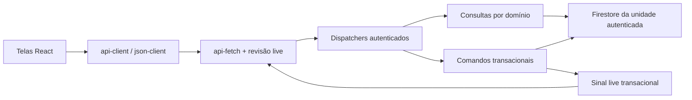

# Arquitetura e contratos operacionais

A aplicação permanece um monólito modular com as mesmas 12 funções HTTP. Não houve
migração ou exclusão de dados. Clientes antigos continuam recebendo os contratos
anteriores, salvo a proteção explícita contra novas movimentações legadas de um
produto já pertencente ao catálogo operacional.

## Fronteiras

- `src/json-client.js`: transporte JSON puro, testável sem Firebase. Obtém identidade
  e token a cada chamada, preserva status/código/dados de erro, não repete mutações.
- `src/api-client.js`: ligação com a sessão real e o wrapper de cache existente.
- `src/api-fetch.js` e `src/read-policy.js`: escopo, coalescing, quota e dependências
  live. Sem conexão confirmada, não se aplica o reuso prolongado de snapshots.
- `shared/operation-day.js`: calendário único de São Paulo, separado de instantes UTC.
- `server/permissions/v31-policy.js`: grupos e capacidades compartilhados. Regras
  especiais de criar administrador, titularidade e aprovação continuam explícitas.
- `server/operations/read-catalog.js`: composição de produto, perfil, saldo e definição.
- `server/operations/stock-queries.js`: histórico, lotes, resumo e atividade físicos.
- `server/production/workspace.js`: receitas e catálogo da tela de produção.
- `server/team/notifications-handler.js`: inbox pessoal e seu ciclo de vida.
- `src/ui/PageHeading.jsx`, `DataState.jsx` e `primitives.css`: cabeçalho, estado inicial
  e tokens comuns. Fluxos especializados mantêm sua semântica e seus controles próprios.

Autenticação e resolução da unidade ficam nos dispatchers. Os contextos passados
às consultas e serviços são criados pelo servidor, nunca aceitos do payload. A
verificação gerencial em `members/manage` permanece antes das actions administrativas.
As escritas críticas continuam verificando acesso dentro da transação.

## Escopos de estoque

| Escopo | Fonte | Regra |
| --- | --- | --- |
| Físico da cozinha | `physicalBalances` e `physicalLots` | Fonte das novas operações operacionais de reserva/giro |
| Compatibilidade física | `v3PhysicalBalances` | Fallback somente quando falta o documento físico atual |
| Por armazenamento | `storageBalancesV1.byStorage` | Saldo independente por local; nunca somado automaticamente ao físico |
| Antigo | `products.quantity` e `movements` | Histórico e compatibilidade de itens ainda não operacionais |

`stock-scope.js` impede arquivar produto com saldo aplicável não zerado ou saldo
existente inconsistente. O físico atual prevalece sobre seu fallback legado; saldo
por armazenamento continua sendo uma verificação independente.

A API antiga rejeita novas movimentações para produtos `56-v1`, apontando para os
fluxos de recebimento/estoque físico. Para os itens ainda legados, usa a mesma regra
central de precisão/unidade e emite sinal de atualização. O histórico não é removido.

Unificar esses escopos em um único número seria uma **migração de negócio**, não uma
extração de código: exige inventário e reconciliação dos dados reais. Esta entrega
não executa essa migração nem inventa equivalência entre saldos.

## Interface e compatibilidade

Cabeçalhos de Cozinha, Produção, Estoque, Insumos, Pessoas e Armazenamentos usam o
mesmo componente. Os estados de primeira consulta/erro das telas de estoque usam
um componente comum e não representam falha como zero. CSS de páginas e ajustes
responsivos que têm função distinta foram preservados.

Mentor, Checklists e Etiquetas são carregados sob demanda, mantendo o chrome e a
sessão montados. O fallback é explícito. Protótipos de recebimento e dashboard ficam
em `qa/demos`, fora das entradas operacionais. Um protótipo não é uma tela publicada.

## Limites mantidos por integridade

Históricos antigos ainda podem exigir scans caros em um cache miss. Não foram
truncados nem substituídos por acumulados inventados. Rascunho/publicação, presença/
previsão, pessoa/conta e evidência/avatar permanecem conceitos distintos. Adaptadores
Firebase Storage e Cloudinary continuam respeitando privacidade e retenção próprias.
